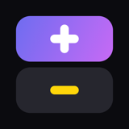
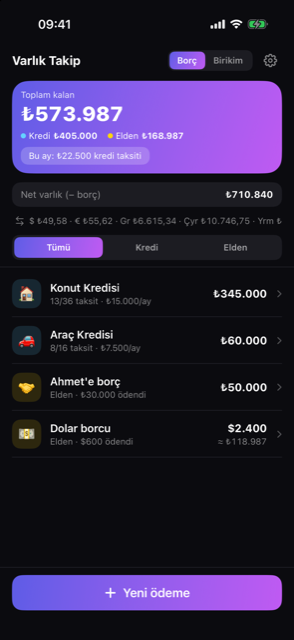
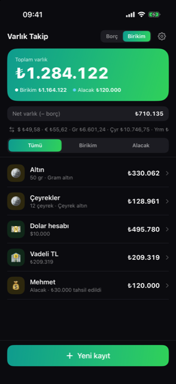
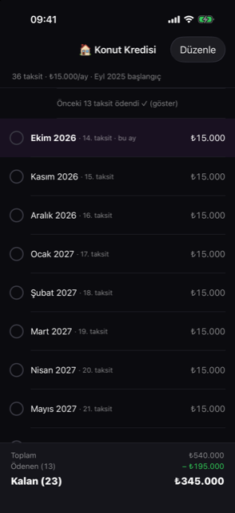
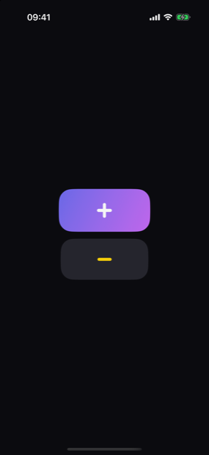
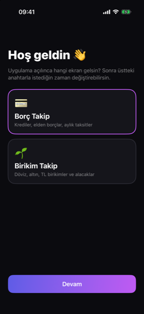
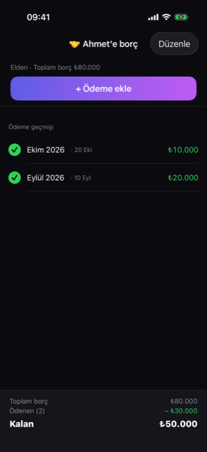

<p align="center">
  
</p>

<h1 align="center">Varlık Takip</h1>

<p align="center">
  Borçlarını, kredi taksitlerini, birikimlerini ve alacaklarını tek yerde takip eden,<br>
  güncel döviz ve altın fiyatlarıyla her şeyi TL'ye çeviren kişisel iOS uygulaması.
</p>

<p align="center">
  
  
  
</p>

---

## Özellikler

### Borç Takip
- **Kredi:** taksit sayısı, aylık tutar ve ilk taksit ayı girilir. Her ay dokunarak "ödendi" işaretlenir (yeşil ✓), kalan tutar anında düşer. Ödenmiş eski aylar katlanır, liste bu aya kayar.
- **Elden borç:** toplam borç girilir; her ödeme yapıldığında o ay ödenen tutar elle eklenir. Kalan borçtan fazlası girilemez.
- **"Bu ay" bilgisi:** bu ay vadesi gelen ödenmemiş kredi taksitlerinin toplamı.
- **Aylık bildirim:** her ayın 1'i saat 09:00'da kredi taksitleri ve kalan elden borç **ayrı satırlarda**, TL karşılığıyla bildirilir (yerel bildirim, sunucu gerektirmez).

### Birikim Takip
- **Birikim kalemleri:** TL, dolar, euro veya altın (gram, çeyrek, yarım, tam, reşat). "+ Ekle / − Çıkar" ile hareket girilir, geçmiş tutulur; eldekinden fazlası çıkarılamaz.
- **Alacak:** sana borçlu olunan tutarlar; tahsilat geldikçe eklenir, kalan alacak düşer.
- **Net varlık:** birikim + alacak − borç, her iki ana sayfada.

### Döviz ve altın
- Dolar ve euro: **TCMB** günlük döviz satış kuru.
- Altın: gram, çeyrek, yarım, tam, reşat satış fiyatları (ücretsiz piyasa servisi, resmi değil).
- Tüm döviz ve altın kayıtlar **her ekranda TL karşılığıyla** gösterilir; toplamlar TL'dir.
- Fiyatlar uygulama her açıldığında yeniden çekilir. İnternet yoksa son alınan fiyat kullanılır, hata gösterilmez.

### Kullanım kolaylığı
- Üstteki **Borç | Birikim** anahtarıyla iki ekran arasında anında geçiş.
- **Açılış ekranı:** ilk kurulumda sorulur, sonra ⚙️ Ayarlar'dan değiştirilir.
- Özet alanı sabit kalır, sadece liste kayar; "＋ Yeni ödeme / Yeni kayıt" butonu altta sabittir ve hiçbir satırı örtmez.
- Küçük ekranlara ve büyük yazı boyutlarına (Dynamic Type, erişilebilirlik boyutları) uyumlu.
- Koyu tema, Türkçe arayüz, `tr_TR` sayı biçimi (`₺1.500,50`).

## Ekran görüntüleri

| Açılış | İlk kurulum | Borç | Birikim | Kredi detayı | Elden borç detayı |
|:---:|:---:|:---:|:---:|:---:|:---:|
|  |  |  |  |  |  |

> Görüntülerdeki kayıtlar örnek veridir.

## Teknik

| | |
|---|---|
| Platform | iOS 17+, sadece iPhone, portre |
| Dil / UI | Swift 6, SwiftUI |
| Veri | SwiftData (sadece cihazda, bulut yok) |
| Bildirim | UserNotifications (yerel, ayın 1'i 09:00) |
| Kur kaynakları | TCMB `today.xml`, finans.truncgil.com (altın) |
| Proje | XcodeGen (`project.yml`) |
| Test | Swift Testing (birim) + XCUITest (ekran akışları) |
| Harici paket | Yok |

### Proje yapısı

```
OdemeTakip/
  App/        Uygulama girişi, kök görünüm, kalıcılık, DEBUG örnek veri
  Models/     SwiftData modelleri (Payment, CashPayment, Asset, AssetMovement)
  Logic/      Saf hesap katmanı: tutar biçimi, kur çevirisi, taksit takvimi, bildirim içeriği
  Services/   Kur deposu (RateStore), bildirim planlayıcı
  Views/      Ana sayfalar, detaylar, formlar, ortak bileşenler
OdemeTakipTests/     Birim testleri
OdemeTakipUITests/   Ekran akışı testleri
docs/                Tasarım dokümanı, planlar, kurulum rehberi, ekran görüntüleri
scripts/             Uygulama ikonu üretici
```

## Kurulum

iPhone'a ücretsiz Apple ID ile kurulum adımları için: **[docs/KURULUM.md](docs/KURULUM.md)**

Kısaca:
1. `brew install xcodegen && xcodegen generate`
2. `open OdemeTakip.xcodeproj` → Signing & Capabilities → kendi Team'ini seç
3. iPhone'u seç → **Run (⌘R)**

> Ücretsiz Apple ID ile imza 7 gün geçerlidir; haftada bir Xcode'dan yeniden Run yapılmalıdır (veriler korunur).

## Geliştirme

```bash
# Proje dosyasını üret
xcodegen generate

# Tüm testler (birim + UI)
xcodebuild test -project OdemeTakip.xcodeproj -scheme OdemeTakip \
  -destination 'platform=iOS Simulator,name=iPhone 17'

# Uygulama ikonu
swift scripts/make-icon.swift OdemeTakip/Resources/Assets.xcassets/AppIcon.appiconset/AppIcon.png
```

DEBUG build'de kullanılabilen açılış argümanları:

| Argüman | Etki |
|---|---|
| `-seedSampleData` | Veri yoksa örnek kayıtlar ekler |
| `-resetData` | Tüm kayıtları siler |
| `-fakeRates` | Ağsız sabit kur ve altın fiyatı |
| `-startMode debt\|savings\|none` | Açılış ekranını ayarlar (`none` = ilk kurulum sorusu) |
| `-testNotification` | 5 sn sonra bu ayın bildirimini gösterir |

## Notlar

- Altın fiyatları resmi olmayan bir servisten gelir; servis yanıt vermezse son alınan fiyat kullanılır.
- Tüm veriler sadece cihazda saklanır; uygulama silinirse veriler de silinir.
